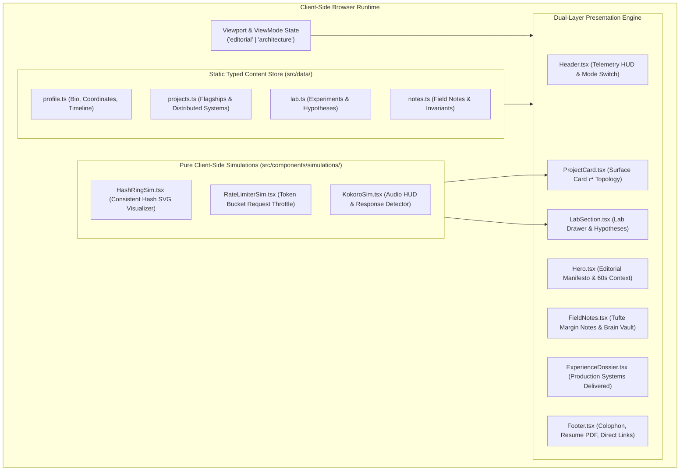

# System Design — Manish Sahu Personal Portfolio

> **High-craft, zero-backend personal portfolio application built on the Hybrid Paradigm (Editorial Monograph & Field Notes $\leftrightarrow$ Deconstructed Architecture & Workbench).**

---

## 1. Vision & MVP Boundaries

### The Elevator Pitch
A distinctive personal digital product that answers three questions within 60 seconds:
1. **Who is Manish as an engineer?** A systems thinker, toolmaker, and product builder who reasons from first principles.
2. **What kinds of systems and products does he build?** Autonomous browser operating substrates (`WebOS.ai`), streaming AI browser extensions (`Kokoro Chat Reader`), distributed rate limiting engines and microservices (`DistributedRateLimiter`, `EventServices`), and low-level prototypes.
3. **How does he think about engineering?** Continuous inquiry, transparent about trade-offs, separates finished products from experimental prototypes, and measures how things behave under load.

### Core Invariants
* **Zero Backend, Zero Database**: 100% client-side static compilation. All models, telemetry, and notes are compiled into typed TypeScript constants. Zero server cost, 0ms network latency, immune to server outages.
* **The Hybrid Paradigm**:
  - **Layer 0 (Editorial Monograph)**: Fast, punchy typographic narrative for recruiters and hiring managers who need to assess seniority and impact in 60 seconds.
  - **Layer 1 (Deconstructed Architecture)**: Deep technical inspection mode for tech leads and staff engineers who want to inspect distributed service boundaries, event pipelines, and failure domains.
* **Radical Honesty**: Finished products (`WebOS.ai`, `Kokoro`, `ReadMeGen`) are showcased as complete; unfinished experiments (`Adaptive Shard Manager`, `Search Engine From Scratch`) are placed in a dedicated **Engineering Lab** with explicit status flags.

### Scope Boundaries
| Dimension | Included in v1 (MVP) | Deferred to v2 |
| :--- | :--- | :--- |
| **Runtime** | 100% Client-side React 19 + TypeScript + Vite | Headless CMS or backend API |
| **Layer Toggle** | Instant switch (`Space` or HUD toggle) between Editorial and Deconstructed views | Multi-window dockable tabs |
| **Simulations** | Pure client-side Token Bucket Simulator, Consistent Hash Ring Visualizer, Kokoro Audio HUD simulator | WASM-based BM25 full-text indexing engine |
| **Styling** | Tailwind CSS + Custom Typography + Hairline Drafting Grid | WebGL / 3D canvas shaders |
| **Deployability** | Single-command static build (`dist/`) deployable to GitHub Pages or Cloudflare | SSR server infrastructure |

---

## 2. Module Map & Architecture



---

## 3. Data Models & Concrete TypeScript Types

To eliminate guesswork during implementation, all data structures are strictly typed:

```typescript
// src/types/index.ts

export type ViewMode = 'editorial' | 'architecture';

export type ProjectTier = 'flagship' | 'distributed' | 'lab';

export interface ArchitectureNode {
  id: string;
  label: string;
  role: string;
  tech: string;
  notes?: string;
}

export interface ArchitectureEdge {
  from: string;
  to: string;
  protocol: 'HTTP' | 'CDP' | 'Kafka' | 'AOP' | 'Redis' | 'DOM Event';
  description: string;
}

export interface ArchitectureSpec {
  nodes: ArchitectureNode[];
  edges: ArchitectureEdge[];
  invariants: string[];
  tradeOffs: {
    decision: string;
    chosen: string;
    alternative: string;
    reason: string;
  }[];
}

export interface Project {
  id: string;
  title: string;
  tagline: string;
  tier: ProjectTier;
  category: 'Browser Engine' | 'Distributed Systems' | 'Full-Stack AI' | 'Developer Tool';
  status: 'Finished Product' | 'Production Ready' | 'Lab Prototype' | 'Benchmarking';
  problem: string;
  solution: string;
  techStack: string[];
  metrics?: { label: string; value: string }[];
  githubUrl: string;
  liveUrl?: string;
  architecture: ArchitectureSpec;
  hasInteractiveSim?: 'rate-limiter' | 'hash-ring' | 'kokoro' | null;
}

export interface LabExperiment {
  id: string;
  title: string;
  hypothesis: string;
  status: 'Prototype Validated' | 'In Progress' | 'Active Benchmark' | 'Mathematical Foundation';
  completionPct: number;
  keyTakeaway: string;
  techStack: string[];
  githubUrl: string;
}

export interface FieldNote {
  id: string;
  slug: string;
  title: string;
  date: string;
  readingTime: string;
  topic: 'Distributed Systems' | 'Browser Architecture' | 'First-Principles' | 'System Design';
  summary: string;
  takeaway: string;
  content: string[];
}

export interface ProductionExperience {
  period: string;
  role: string;
  organization: string;
  summary: string;
  systemsOwned: string[];
  scaleMetrics: { metric: string; detail: string }[];
  keyDecisions: string[];
}

export interface Profile {
  name: string;
  title: string;
  location: string;
  thesis: string;
  currentBets: { title: string; desc: string; status: string }[];
  socials: {
    github: string;
    linkedin: string;
    email: string;
  };
  resumePdfUrl: string;
}
```

---

## 4. UI Layout & Viewport Invariants

```
┌─────────────────────────────────────────────────────────────────────────────┐
│ HUD HEADER: [Manish Sahu / Systems]          [Mode: Editorial ⇄ Architecture]│
├─────────────────────────────────────────────────────────────────────────────┤
│ HERO:                                                                       │
│   Who I Am: Software Engineer building systems, tools, and experiments      │
│   Current Focus: Autonomous browser runtimes & local-first architectures    │
├─────────────────────────────────────────────────────────────────────────────┤
│ SELECTED WORK (Layer 0 = Prose & Impact  |  Layer 1 = Topology & Data Flow)│
│   01. WebOS.ai           (Autonomous Browser Substrate / CDP / AXTree)      │
│   02. Kokoro Chat Reader (Streaming TTS Chrome Extension / Audio HUD)       │
│   03. ReadMeGen.AI       (Microservices AI Platform / Spring / Ollama)      │
├─────────────────────────────────────────────────────────────────────────────┤
│ DISTRIBUTED SYSTEMS DEEP DIVE:                                              │
│   04. Distributed Rate Limiter Core & Microservices (Spring Starter / Redis)│
│       [Interactive Token Bucket / Request Spike Simulator]                 │
│   05. Event Service Microservices (Eureka / JWT / Spring Cloud UML)         │
├─────────────────────────────────────────────────────────────────────────────┤
│ THE ENGINEERING LAB (Unfinished Work with Transparent Flags):               │
│   • Adaptive Shard Manager [Prototype: Hash Ring Validated]                 │
│     [Interactive Consistent Hash Ring Rebalancer]                           │
│   • Search Engine From Scratch [Inverted Index & BM25 Scorer]               │
│   • Neural Network From Scratch [Perceptrons & Backpropagation Math]        │
├─────────────────────────────────────────────────────────────────────────────┤
│ FIELD NOTES & OBSIDIAN BRAIN:                                               │
│   Reflections on Invariants, Distributed Consensus, and Local-First Tooling │
├─────────────────────────────────────────────────────────────────────────────┤
│ PRODUCTION DOSSIER (Professional Career Experience & Scale Delivered)       │
├─────────────────────────────────────────────────────────────────────────────┤
│ COLOPHON & RESUME: [Direct 1-Click Resume PDF Download] [GitHub] [LinkedIn] │
└─────────────────────────────────────────────────────────────────────────────┘
```
